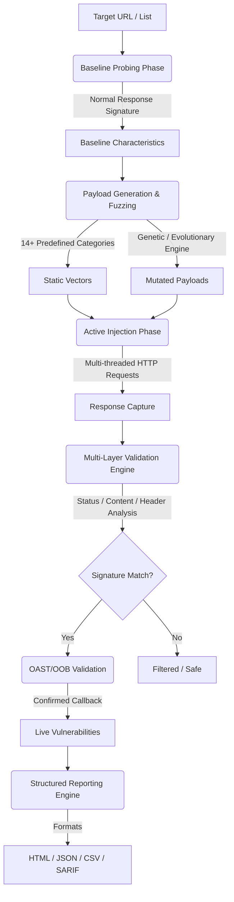

# 󰳆 PhantomHeader

<p align="center">
  
  
  
  
</p>

```text
██████╗ ██╗  ██╗ █████╗ ███╗   ██╗████████╗ ██████╗ ███╗   ███╗
██╔══██╗██║  ██║██╔══██╗████╗  ██║╚══██╔══╝██╔═══██╗████╗ ████║
██████╔╝███████║███████║██╔██╗ ██║   ██║   ██║   ██║██╔████╔██║
██╔═══╝ ██╔══██║██╔══██║██║╚██╗██║   ██║   ██║   ██║██║╚██╔╝██║
██║     ██║  ██║██║  ██║██║ ╚████║   ██║   ╚██████╔╝██║ ╚═╝ ██║
╚═╝     ╚═╝  ╚═╝╚═╝  ╚═╝╚═╝  ╚═══╝   ╚═╝    ╚═════╝ ╚═╝     ╚═╝

██╗  ██╗███████╗ █████╗ ██████╗ ███████╗██████╗ 
██║  ██║██╔════╝██╔══██╗██╔══██╗██╔════╝██╔══██╗
███████║█████╗  ███████║██║  ██║█████╗  ██████╔╝
██╔══██║██╔══╝  ██╔══██║██║  ██║██╔══╝  ██╔══██╗
██║  ██║███████╗██║  ██║██████╔╝███████╗██║  ██║
╚═╝  ╚═╝╚══════╝╚═╝  ╚═╝╚═════╝ ╚══════╝╚═╝  ╚═╝
```

**PhantomHeader** is a next-generation, high-concurrency security scanner designed to identify **Host Header Injection (HHI)**, **Web Cache Poisoning**, **Web Cache Deception**, and **Virtual Host (VHost) routing bypasses**. 

Equipped with an **Evolutionary Fuzzing Engine (Genetic Algorithm)**, it dynamically mutates and crafts payloads to bypass Web Application Firewalls (WAFs) and identify subtle configuration mismatches in multi-tier reverse proxies.

---

## 󰏗 Key Features

- 󰦛 **14+ Attack Categories**: Tests absolute URL injections, duplicate host headers, HTTP header splitting (CRLF), Unicode normalization bypasses, null-byte terminations, and override headers (`X-Forwarded-Host`, `X-Host`, etc.).
- 󰓾 **Evolutionary Fuzzing Engine**: Evolves fuzzing payloads over generations using mutation and selection strategies to optimize for target-specific WAF evasion.
- 󰄳 **Multi-Layer Validation**: Prevents false positives by cross-analyzing reflections, status code deviations, response body structural changes, and redirect locations.
- 󰔞 **Out-of-Band (OAST) Integration**: Support for OAST validation endpoints to detect blind SSRF and OOB interactions.
- 󰮏 **CI/CD Native**: Direct **SARIF** and **JSON** output formats for seamless integration into GitHub Actions, GitLab CI, or DevSecOps pipelines.

---

## 🗺️ Engine Architecture & Pipeline

PhantomHeader operates using a structured pipeline that ensures maximum vulnerability detection coverage while maintaining zero false positives:



### Pipeline Breakdown
1. **Baseline Probing Phase**: Before running any fuzzing vectors, PhantomHeader establishes a response baseline for each target to capture its normal status codes, response headers, reflections, and body structure.
2. **Payload Generation & Fuzzing**:
   - **Static Vectors**: Over 200+ target-independent vectors distributed across 14+ different attack categories (Absolute URLs, duplicate Host headers, override headers, Unicode normalization, CRLF injection, etc.).
   - **Evolutionary/Genetic Engine**: If enabled, payloads undergo multiple generations of mutation (e.g. bit flipping, byte deletion, unicode modification) and selection to optimize for WAF evasion.
3. **Active Injection Phase**: Dispatches requests concurrently over configured worker threads, throttling request rates to respect targets.
4. **Multi-Layer Validation Engine**: Compares test responses against the baseline to filter out false positives by analyzing status code deviations, response body structural integrity, reflection differences, and redirects.
5. **OAST/OOB Validation**: Optionally sends a unique callback token to OAST servers (e.g., Interact.sh) to identify blind SSRF or Host Header injection callbacks.
6. **Structured Reporting**: Aggregates final findings into standard machine-readable and human-readable reporting formats.

---
## 󰏖 Installation

### From Binary
Ensure you have Go 1.21 or higher installed:

```bash
go install -v github.com/youwannahackme/phantomheader@latest
```

### From Source
```bash
git clone https://github.com/youwannahackme/phantomheader.git
cd phantomheader
go build -o phantomheader
```

---

## 󰖟 Quick Start & Usage

### 1. Basic Scan
Scan a single target URL or raw domain (schemes are auto-prefixed):
```bash
phantomheader scan https://example.com
```

### 2. Scan with Authenticated Sessions (Cookies)
Inject custom session or authentication cookies:
```bash
phantomheader scan https://example.com --cookies "PHPSESSID=abc123xyz; security=high"
```

### 3. Scan Multiple Targets from a File
Scan a list of targets concurrently with custom thread counts:
```bash
phantomheader scan-file targets.txt --concurrency 20 --delay 50
```

### 4. Advanced WAF Bypass (Select Categories)
Run a focused scan targeting specific payload categories:
```bash
phantomheader scan https://example.com -C absolute_url -C duplicate -C line_feed
```

---

## 󰏓 CLI Reference

### `scan` Command Options
| Option | Aliases | Description | Default |
| :--- | :--- | :--- | :--- |
| `--concurrency` | `-c`, `--workers` | Number of concurrent worker threads | `10` |
| `--timeout` | `-t` | Request timeout in seconds | `30` |
| `--delay` | `-d`, `--throttle` | Delay between requests in milliseconds | `100` |
| `--cookies` | `-b`, `--cookie` | Session cookies (`Name=Value; Name2=Value2`) | None |
| `--header` | `-H` | Custom headers (`Name: Value`) | None |
| `--proxy` | `-x` | HTTP/S proxy URL (e.g. `http://127.0.0.1:8080`) | None |
| `--output-format` | `-o`, `--format` | Output format: `table`, `json`, `csv`, `html`, `yaml`, `sarif` | `table` |
| `--output` | `-O`, `--report` | Output file path (e.g. `report.json`, `report.sarif`, `report.zip`) | None |

---

## 󰒲 CI/CD Integration

You can integrate PhantomHeader into your GitHub Actions workflow using the following job step:

```yaml
- name: Run PhantomHeader Scan
  run: |
    ./phantomheader scan-file targets.txt --output report.zip
```

---

## 󰏔 Comparison with Other Tools

| Feature | **PhantomHeader** | **Headi** | **Param Miner** | **Nuclei** |
| :--- | :--- | :--- | :--- | :--- |
| **Primary Focus** | HHI / Cache Poisoning | Header Injection | Parameter Discovery | General Scanning |
| **Fuzzing Engine** | **Evolutionary (Genetic)** | Static Lists | Heuristic (Unkeyed) | Static Payloads |
| **Bypass Techniques**| Unicode, CRLF, Null-Byte | Basic Overrides | Cache-Poisoning | Template-Based |
| **CI/CD Ready** | **Yes** (SARIF / JSON) | No | No | Yes |

---

## 󰏎 License

Distributed under the MIT License. See [`LICENSE`](LICENSE) for more information.

Developed and maintained by **[whoami_404](https://github.com/youwannahackme/phantomheader)**.
