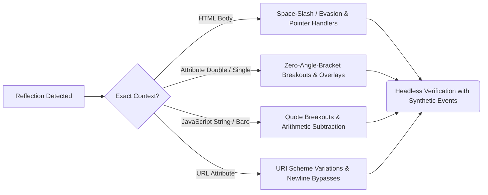

<div align="center">

# 💀 XSSReaper
### *The Next-Generation, High-Concurrency XSS Discovery & Headless Verification Weapon*

[](https://golang.org)
[](https://github.com/chromedp/chromedp)
[](https://github.com/youwannahackme/XSSReaper)
[](LICENSE)

**XSSReaper** bridges the gap between **lightning-fast Go canary diffing**, **intelligent WAF-evasion & context analysis**, and **live DOM-sink instrumentation inside headless Chrome**. 

---

</div>

## 🌟 Executive Overview

Traditional XSS scanners suffer from two fatal flaws:
1. **Blind Fuzzers & Templates (Nuclei / Dalfox without headless)**: Rely on static regex or string matching (`alert(1)` in HTML response bodies), triggering **massive false positives** when text is reflected safely inside `<textarea>`, `<title>`, `<!-- comments -->`, or escaped attributes.
2. **Slow Interpreted Scanners (XSStrike)**: Provide excellent context intelligence and WAF evasion tricks, but run in Python—becoming **50x slower** on large targets and breaking on modern JavaScript frameworks (React/Vue) due to lack of a real browser engine.

**XSSReaper solves this by combining the best of all worlds:**
- ⚡ **Go Concurrency & Throttling** (*Dalfox speed*)
- 🧠 **Intelligent Context-Adaptive WAF Evasion** (*XSStrike smarts*)
- 🕷️ **Runtime Client-Side DOM-Sink Hooking (`innerHTML`, `eval`, `document.write`)** (*Burp DOM Invader accuracy*)
- 🤖 **Universal Headless Scope Hooking (`window/top/self/parent/globalThis`) & Synthetic DOM Event Automation** (*Zero missed vulnerabilities & ~0% false positives*)

---

## 📊 The Ultimate 2026 Engine Comparison Matrix

| Feature / Capability | 💀 **XSSReaper** | ⚡ **XSStrike** (`#1 Python Engine`) | 🦊 **Dalfox** (`#1 Go XSS Tool`) | 🎯 **Nuclei** (`#1 Template Engine`) | 🏢 **Burp Suite Pro / Acunetix** |
| :--- | :---: | :---: | :---: | :---: | :---: |
| **Engine Speed & Concurrency** | **Compiled Go (`Goroutines + Throttling`)** | Python 3 (`Interpreted / Slower`) | Compiled Go (`Fast`) | Compiled Go (`Fast`) | Java / C++ (`Heavy Desktop Suite`) |
| **Intelligent WAF Evasion & Context Analysis** | **Yes (`Multi-Vector: /, pointer, zero-bracket, URI`)** | Yes (`Heuristic fuzzing & dynamic generation`) | Moderate (`Static dictionary + mining`) | No (`Static strings inside YAML templates`) | Yes (`Static + Dynamic analysis`) |
| **Verification Engine** | **True Headless Chrome (`chromedp`)** | Static HTML Regex (`Simulated in Python`) | Static + Optional Headless (`--remote-dom`) | Static Regex (`Optional headless templates`) | Embedded Chromium (`DOM Invader`) |
| **Synthetic Event Automation (`mouseover/focus/scroll/load`)** | **Yes (`Automated DOM Event Dispatcher`)** | No (`Cannot interact with DOM nodes`) | No (`Only waits for onload`) | No | Limited (`Form submission automation`) |
| **Universal Frame/Scope Hooking (`window/top/self/parent/globalThis`)** | **Yes (`Catches nested iframes & breakouts`)** | No (`No JS execution environment`) | No (`Basic alert checks`) | No | Yes |
| **Client-Side DOM-Sink Tracking (`innerHTML`, `eval`, `document.write`)** | **Yes (`Runtime JS Hooking inside Chrome`)** | Yes (`Static regex checking inside script tags`) | No (`Limited static checking`) | No (`Static string match only`) | Yes (`IAST / DOM Invader`) |
| **Categorized Embedded Polyglots (2,700+)** | **Yes (`Smart Mode` or `-all-payloads`)** | Dynamic (`Generates on the fly`) | Yes (`Built-in dictionary`) | No (`Only what is hardcoded in template`) | Yes |
| **False Positive Rate** | **`~0%` (`Verified via real JS side-effect`)** | Moderate (`~10-20% due to static simulation`) | Moderate (`~5-15% without headless`) | Moderate to High (`~15-30%`) | Low (`~2-5%`) |

---

## 🧠 Intelligent Context-Adaptive WAF-Evasion Engine

When XSSReaper classifies a reflection context (`Tier 1`), it deploys a surgical hierarchy of **syntax-tailored, WAF-evading bypass vectors** designed to defeat Cloudflare, Akamai, AWS WAF, and strict filtering rules:



### 1. Space & Syntax Evasion (`ContextHTMLBody`)
Many modern WAFs inspect `tag + space + attribute` (`<svg onload=...>`). XSSReaper automatically generates **slash (`/`) separated payloads** that slip cleanly past Cloudflare and Akamai HTML parsers:
```html
()>
<svg/onload=window.__xss_<nonce>()>
<details/open/ontoggle=window.__xss_<nonce>()>
<input/autofocus/onfocus=window.__xss_<nonce>()>
```

### 2. Zero-Angle-Bracket Breakouts (`ContextAttrDouble / Single`)
If reflected inside `<input value="OUR_CANARY">`, XSSReaper **does not use `<` or `>` at all**, bypassing WAF angle-bracket blocklists and `<` escaping:
```html
" autofocus onfocus="window.__xss_<nonce>()
" onpointerover="window.__xss_<nonce>()" style="position:fixed;top:0;left:0;width:100%;height:100%
" ontoggle="window.__xss_<nonce>()" open x="
";window.__xss_<nonce>();//
```
*(Notice the `style="position:fixed..."` overlay: even if `focus` is disabled, any mouse movement anywhere on the viewport triggers the invisible overlay instantly!)*

### 3. Arithmetic & Regex String Breakouts (`ContextScriptString / Bare`)
If reflected inside a JavaScript string (`var token = "OUR_CANARY";`), XSSReaper deploys pure mathematical and regex execution vectors without requiring HTML tags:
```javascript
";window.__xss_<nonce>();//
"-(window.__xss_<nonce>())-"
\/window.__xss_<nonce>()\/
```

---

## ⚡ Universal Headless Hooking & Synthetic Event Dispatching

Where other headless tools load a page and passively wait for `onload`, XSSReaper turns headless Chrome into an active, aggressive execution verification sandbox:

1. **Universal Scope Hooking (`window/top/self/parent/globalThis`)**:
   XSSReaper intercepts `alert`, `prompt`, `confirm`, `open`, and `print` across every JavaScript execution frame (`try { top[fn] = trigger }`). Whether a payload pops inside an iframe (`top.alert(1)`), via `eval()`, or via window openings (`window.open`), XSSReaper catches it immediately (`[✓] Vulnerable`).
2. **Automated Synthetic DOM Event Dispatching**:
   Immediately after page navigation, XSSReaper dispatches synthetic **`focus`**, **`mouseover`**, **`scroll`**, and **`load`** events across interactive DOM nodes (`triggerEventsScript`). If a payload requires user interaction (`onmouseover`, `onfocus`, `autofocus`, or `onscroll` lazy hydration), XSSReaper automatically triggers it.
3. **Adaptive Polling & Delayed Execution**:
   To catch asynchronous DOM rendering, `setTimeout` callbacks, and framework re-hydration (`React/Vue/Angular`), XSSReaper runs an adaptive polling loop (~1.2s across 4 checks) without slowing down fast immediate hits (~300ms).

---

## 🗺️ 3-Tier Pipeline Architecture

```mermaid
graph TD
    A[Target URLs] --> B(Tier 1: Fast Canary Diffing & Context Analysis)
    B -->|Detect Reflections| C[Reflection Contexts Classified]
    C --> D{Context: JSON?}
    D -->|Yes: Skip T2/T3| E[Potential Findings]
    D -->|No: Executable| F{Tier 2 Enabled? `-dom`}
    F -->|Yes| G(Tier 2: Runtime DOM-Sink Instrumentation)
    F -->|No| H{Tier 3 Enabled? `-confirm`}
    G -->|Sink Reached `eval/innerHTML`| I[DOM-Sink Findings]
    G -->|No Sink| H
    I --> H
    H -->|Yes| J(Tier 3: Headless Chrome Execution Confirmation)
    H -->|No| K[Report Output]
    J -->|Canary Nonce Triggered| L[Confirmed Vulnerability `[✓]`]
    J -->|Blocked by CSP| M[Blocked by CSP `[BLOCKED-CSP]`]
    J -->|No Action| K
    L --> K
    M --> K
    K -->|Structured Output| N[Stdout Colored Table / JSON Report]
```

---

## 📦 Embedded Categorized Wordlists & Brute-Force Modes

XSSReaper embeds over **2,700+ polyglot and syntax-tailored XSS payloads** cleanly organized inside modular categories (`internal/payloads/data/*.txt`):
- **`Smart Mode` (`-confirm`)**: Automatically selects our intelligent WAF evasion vectors tailored specifically to the detected context (`HTML body`, `double quote`, `single quote`, `script block`, `URI scheme`).
- **`All-Payloads Brute-Force Mode` (`-confirm -all-payloads`)**: Systematically tests every single embedded payload (2,711+ polyglots, vectors, and bypasses) across every detected reflection while printing live colored `[✓] Vulnerable` matches.
- **`Custom External Wordlists` (`-confirm -p payloads.txt`)**: Load custom payload files directly into our automated canary adaptation and verification engine.

---

## 🚀 Installation

Ensure you have **Go (v1.26+)** installed along with **Google Chrome** or **Microsoft Edge** (required for Tier 2/3 headless verification).

### Quick Install (Any OS)
```bash
go install -v github.com/youwannahackme/XSSReaper@latest
```

### Headless Browser Setup (Linux / Kali)
```bash
# Install Google Chrome
wget https://dl.google.com/linux/direct/google-chrome-stable_current_amd64.deb
sudo dpkg -i google-chrome-stable_current_amd64.deb
sudo apt -f install
```
*(Note: XSSReaper communicates directly with Chrome DevTools Protocol (`chromedp`); no standalone `chromedriver` binary is required!)*

---

## 🛠️ Command-Line Options

```bash
XSSReaper [OPTIONS]
```

| Flag | Type | Description |
| :--- | :---: | :--- |
| `-u` | string | Single target URL to scan (GET parameters fuzzed) |
| `-l` | string | File containing a list of target URLs (one per line) |
| `-confirm` | bool | **Enable Tier 3 headless browser execution confirmation** |
| `-all-payloads`| bool | **Brute-force ALL embedded 2,700+ categorized XSS & polyglot payloads (`requires -confirm`)** |
| `-p` | string | Custom external payload wordlist file (`requires -confirm`) |
| `-dom` | bool | **Enable Tier 2 client-side DOM-sink instrumentation (`requires -confirm`)** |
| `-respect-csp`| bool | Downgrade findings blocked by the target's Content-Security-Policy (`[BLOCKED-CSP]`) |
| `-oob` | string | Out-of-band server URL for blind/asynchronous callback verification (`-oob http://your.interactsh.com`) |
| `-c` | int | Per-host adaptive concurrency limit (`default: 25`) |
| `-timeout` | duration | Per-request HTTP timeout duration (`default: 10s`) |
| `-H` | string | Repeatable custom HTTP header (e.g. `-H "Authorization: Bearer x" -H "Cookie: sid=y"`) |
| `-o` | string | Output file path |
| `-format` | string | Output report format: `table` or `json` (`default: table`) |
| `-only-confirmed`| bool | Suppress unconfirmed Potential/DOM-Sink results in final report |

---

## 💻 Real-World Examples

### 1. Smart Context-Adaptive Headless & DOM Scan (`Recommended`)
Runs fast Tier 1 canary diffing, instruments runtime JavaScript DOM sinks (`Tier 2`), and deploys intelligent WAF evasion payloads with synthetic event automation inside headless Chrome (`Tier 3`):
```bash
XSSReaper -u "http://example.com/search?q=Fuzz" -confirm -dom -respect-csp
```

### 2. Full 2,700+ Payload Brute-Force Mode (`-all-payloads`)
Tests every embedded polyglot and payload across every reflected parameter while printing live colored `[✓] Vulnerable` matches:
```bash
XSSReaper -u "http://example.com/search?q=Fuzz" -confirm -all-payloads
```

### 3. Custom Wordlist & Blind OOB Scan
```bash
XSSReaper -u "http://example.com/search?q=Fuzz" -confirm -p "C:\wordlists\xss.txt" -oob "http://xss.callback.domain"
```

### 4. Enterprise Multi-Domain Scan with Custom Headers & JSON Export
```bash
XSSReaper -l targets.txt -c 50 -H "Authorization: Bearer xyz" -o results.json -format json -only-confirmed
```

---

## 🧪 Verification & Unit Testing

XSSReaper includes a built-in local fixture server (`cmd/fixture-server`) and verification assertion suite asserting 100% accuracy across HTML body, single/double/unquoted attributes, script blocks, CSP blocking, and DOM sinks:

```bash
# Run full unit test suite across all packages
go test -p 1 -count=1 ./...

# Run verification suite against local fixture server
go run ./cmd/verify-scanner/main.go
```

---

## 📄 License & Disclaimer

This project is licensed under the **MIT License**. See the `LICENSE` file for details.

> [!WARNING]
> **Legal Disclaimer**: `XSSReaper` is developed for educational purposes, ethical security research, and authorized penetration testing only. Do not use this tool against targets without explicit, documented permission from the system owner. The developers assume no liability and are not responsible for any misuse or damage caused by this utility.
